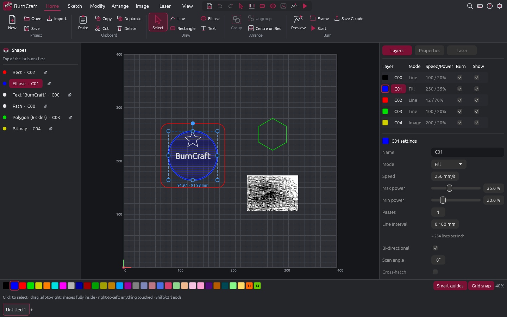

# BurnCraft


**Laser / Engraver Software for Everyone - Written in Rust.**

An open-source laser design and control app: a laser workflow with Photoshop-style image tools and Onshape-style
CAD sketching, that opens LightBurn projects. Runs on Linux, Windows, macOS and in the browser.



> [!WARNING]
> **BurnCraft is rough around the edges.** It's a hobby project for tinkerers, and you should expect bugs.
> If you need stable, mature software for your laser, and can afford it, I recommend
> [LightBurn](https://lightburnsoftware.com/). It's excellent.

## About this project

I'm not a software developer. BurnCraft was built mostly by AI (Claude, through
[Craft Anything](https://github.com/storytold/craft-anything)), with me testing it and steering. It's inspired by
the ArtCraft apps (PhotoCraft, WordCraft and others).

I don't plan to spend a lot of time on this project. Bug reports are welcome, but replies and fixes may be slow or
may never come. If BurnCraft is close to what you need, fork it and make it your own. Using
[Craft Anything](https://github.com/storytold/craft-anything) to refine it for your own machine and workflow is a
good way to do that.

## Laser safety

BurnCraft controls real hardware that can start fires and cause permanent eye damage. It is provided **with no
warranty** (see [LICENSE](LICENSE)). Never leave a running laser unattended. Wear the right eye protection for your
laser's wavelength, keep a fire extinguisher nearby, and know where your emergency stop is. Check every new job
with **Preview** and **Frame** at low power before burning it for real.

## Features

* Opens and saves LightBurn projects (`.lbrn2`, and reads older `.lbrn`).
* Tabbed ribbon (Home, Sketch, Modify, Arrange, Image, Laser, View) with large labelled icons, a quick-access
  bar you can drag any tool onto (12 slots + overflow), and a tool options bar.
* CAD-style navigation: scroll to zoom at the cursor, middle- or right-drag to pan, window selection
  left-to-right and crossing selection right-to-left, `S` / `Ctrl+K` command search.
* Every command has a changeable shortcut (CAD preset or LightBurn preset), conflict warnings, import/export.
* Project tabs along the bottom (Onshape-style); copy and paste between tabs; layer settings can be saved as defaults.
* Sketch: line (Shift = 15° angles), pen/curve, 3-point / centre / tangent arcs, rectangle (rounded), ellipse,
  polygon (rounded), star, text with installed system fonts (bold, italic, case, spacing, weld), QR / Data Matrix /
  Code 128 / EAN-13 / UPC-A / Code 39 barcodes, trim, fillet (round or conic) and chamfer (equal, two distances,
  distance + angle), measure.
* Point editing: multi-select by click, box or lasso, scroll over a point to grow the selection, smooth/corner,
  line/curve, insert, break, delete (LightBurn keys S C L I M B D).
* Modify: weld, union, subtract, intersect (with a live preview on hover), offset (inward/outward/both,
  round/bevel/sharp, simplify, outer shapes only), grid and circular arrays, align, distribute.
* Images: brightness/contrast/gamma, dithering, tracing (precise or smooth curves via VTracer) with a live preview,
  magic wand and (magnetic) lasso selections that become outlines.
* Optional AI outlines with the tool of your choice: Claude, any OpenAI-compatible service (OpenAI, Ollama,
  LM Studio…), or any MCP server. Images are only sent to the service you pick, and only when you use the
  feature. BurnCraft is also an MCP server: `burncraft --mcp`.
* Lasers: GRBL and other G-code controllers over USB/serial: connect, jog, home, frame, start/pause/stop,
  console, estimated/elapsed/remaining time. Animated job preview with play and speed controls; G-code export.
  K40 lasers with the M2 Nano board over USB (home, frame, start, stop, `.egv` files; not yet tested on every
  board). Galvo lasers with an EZCad2 / JCZ (LMC) board over USB: fiber, UV and CO2 sources, lens correction
  files, red-pointer framing (not yet tested on a real machine). Ruida DSP controllers: save `.rd` files or send
  jobs over the network. Shapes outside the bed are left out.
* Variable text from `.csv` / `.txt` rows, serial numbers and the date, moving to the next row after each job.
* Camera overlay: a USB camera (Linux), a network camera's snapshot address or a photo, lined up with four points.
  The network camera address you type is the only place BurnCraft fetches pictures from.
* Imports EZCad2 projects (`.ezd`): shapes, text, pictures, hatches, and pens as layers.
* Built-in help and a replayable Welcome Tour.

## Download

Get the latest version from [Releases](https://github.com/amruthwo/BurnCraft/releases):

| Platform | x86_64 | arm64 | riscv64 | Formats |
|---|---|---|---|---|
| Linux | ✓ | ✓ | ✓ | .deb, .rpm, .AppImage, .flatpak, portable .tar.gz |
| Windows | ✓ | ✓ | | .msi, setup .exe, portable .zip |
| macOS | ✓ | ✓ | | universal .dmg and zipped .app |
| Web / PWA | wasm32 | | | static site (installable) |

**Try it in your browser:** <https://amruthwo.github.io/BurnCraft/>. You can open projects and pictures (or drop
them on the page), and saving or exporting downloads the file. Settings are kept in the browser. It can't connect
to a laser, use a camera or make AI outlines, so use the desktop app for real work.

The installers aren't code-signed. On **Windows**, SmartScreen may warn you: choose *More info → Run anyway*.
On **macOS**, right-click the app and choose *Open* the first time.

## Build from source

```
cargo build --release
```

Every platform is built by `.github/workflows/release.yml` when a `v*` tag is pushed. Locally:
`cargo packager --release` (installers), `cargo generate-rpm` (.rpm),
`flatpak-builder build packaging/flatpak/org.burncraft.BurnCraft.yml` (Flatpak), `trunk build --release web/index.html` (web).

## Command line

```
burncraft [project.lbrn2 | image.png]
burncraft --mcp
burncraft --vectorize picture.png picture.svg
burncraft --screenshot out.png
```

## Licence

BurnCraft is free software: you can redistribute it and/or modify it under the terms of the GNU General Public
License as published by the Free Software Foundation, either version 3 of the License, or (at your option) any
later version. See [LICENSE](LICENSE).

## Credits

- K40 / M2 Nano support is ported from [K40 Whisperer](https://www.scorchworks.com/K40whisperer/k40whisperer.html)
  by Scorch (GNU GPL v2 or later; its speed-code library is MIT licensed).
- Galvo (JCZ / LMC board) support and the EZCad2 file layout follow the open-source
  [MeerK40t](https://github.com/meerk40t/meerk40t) project (MIT licence).
- Their licence notices are in [THIRD-PARTY-NOTICES.md](THIRD-PARTY-NOTICES.md).

## Not affiliated

BurnCraft is an independent project. It is not affiliated with, endorsed by or sponsored by LightBurn Software,
ArtCraft, Craft Anything, or their authors. "LightBurn" is a trademark of its owner and is used here only to
describe file compatibility. Other names are used only to say what inspired BurnCraft and how it was made.
